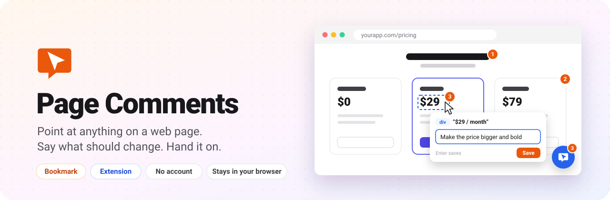
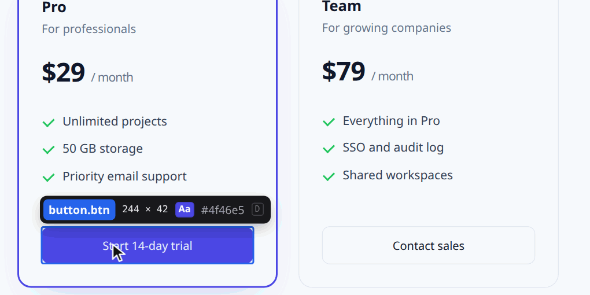
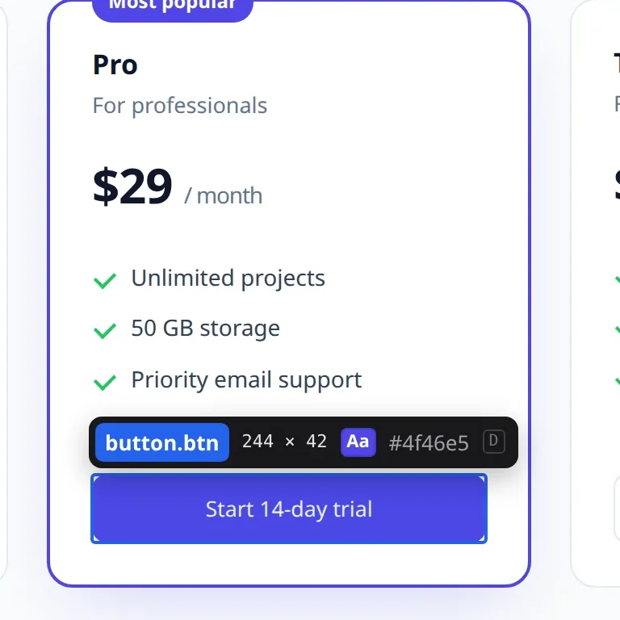
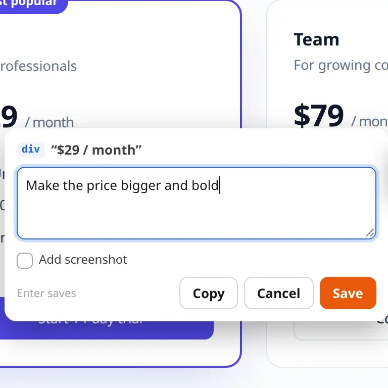
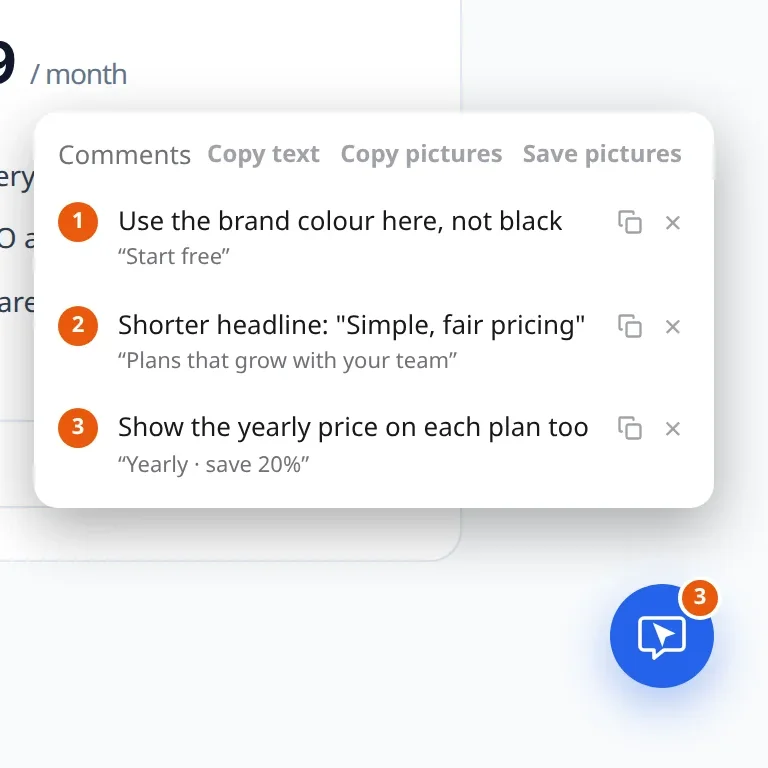
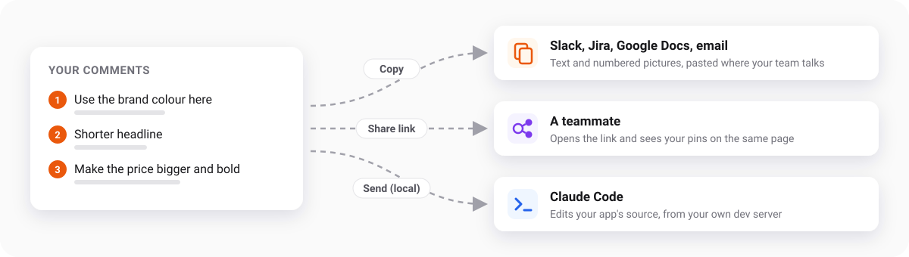
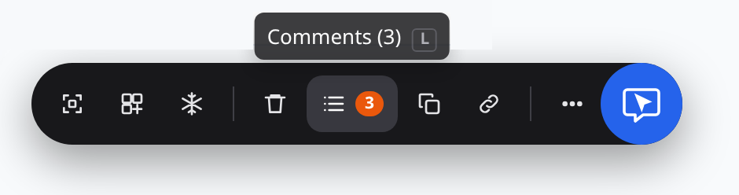
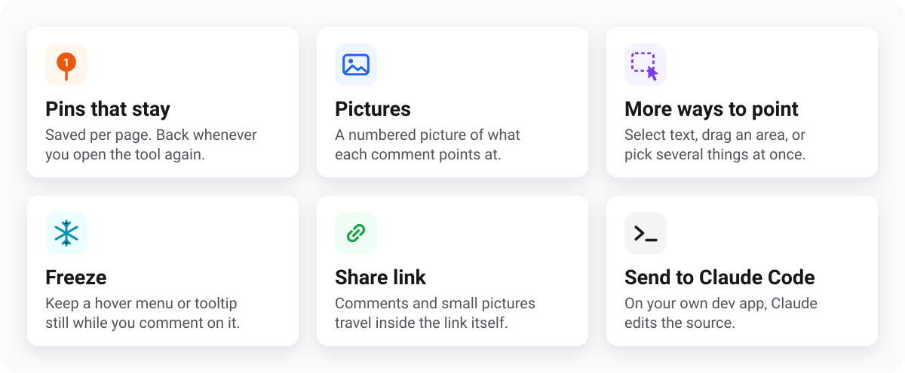

  

  
  
  

  <a href="#-three-ways-to-use-it"><b>Get it</b></a>&nbsp;&nbsp;·&nbsp;&nbsp;<a href="docs/GUIDE.md"><b>Guide</b></a>&nbsp;&nbsp;·&nbsp;&nbsp;<a href="docs/DEVELOPING.md"><b>Developing</b></a>&nbsp;&nbsp;·&nbsp;&nbsp;<a href="CHANGELOG.md"><b>Changes</b></a>

 

  

## ✨ How it works

<table>
  <tr>
    <td width="33%" align="center"></td>
    <td width="33%" align="center"></td>
    <td width="33%" align="center"></td>
  </tr>
  <tr>
    <td align="center"><b>1 · Point</b> Hover anything to see its tag, size and colour.</td>
    <td align="center"><b>2 · Comment</b> Click it, type, press <kbd>Enter</kbd>. A numbered pin stays.</td>
    <td align="center"><b>3 · Hand it on</b> Copy, share a link, or send it to Claude Code.</td>
  </tr>
</table>

## 🚀 Three ways to use it

| |  **The bookmark** |  **Copy it from GitHub** |  **The extension** |
|---|:---:|:---:|:---:|
| **For** | Most people | Networks that reach only github.com | The sharpest pictures |
| **Updates** | By itself | A dot tells you | Through the store |
| **Get it** | **[Install page →](https://page-comments.heyadhi.com/)** | **[bookmarklet.txt →](bookmarklet.txt)** | Stores soon; [Chrome by hand →](https://page-comments.heyadhi.com/?way=extension) |

All three run the same tool and share comments and share links.

<b>Add the GitHub copy as a bookmark</b>

 

1. Open [`bookmarklet.txt`](bookmarklet.txt) and click **Copy raw file**.
2. Right-click the bookmarks bar → **Add page…** (Firefox: **Add Bookmark…**).
3. Name it *Page comments* and paste into **URL**.

<b>Try the extension before it is in the stores</b>

 

1. Download [page-comments-chrome.zip](https://page-comments.heyadhi.com/page-comments-chrome.zip) and unzip it. Keep the folder `page-comments-chrome`: Chrome runs the extension from it.
2. Open `chrome://extensions` and switch on **Developer mode**, top right.
3. Click **Load unpacked** and choose the folder.

Works in Edge, Brave and Opera too. It does not update itself: to update, download again, unzip over the same folder, and press ↻ on the extension. To build it from the source instead, see [Developing → The extension](docs/DEVELOPING.md#the-extension).

## 📮 Where your comments go

  

## 🧰 What it can do

  

  

Send to Claude Code works on your own dev app only. [How it works](docs/GUIDE.md#send-to-claude)

<b>⌨️ Keyboard shortcuts</b>

 

| Key | Does |
|---|---|
| <kbd>Enter</kbd> | Comment on the outlined element |
| <kbd>↑</kbd> <kbd>↓</kbd> | Outline the parent or the inner element |
| <kbd>A</kbd> | Select an area |
| <kbd>B</kbd> | Select several |
| <kbd>F</kbd> | Freeze the page |
| <kbd>L</kbd> | Comments list |
| <kbd>C</kbd> | Copy |
| <kbd>S</kbd> | Share link |
| <kbd>D</kbd> | Details on or off |
| <kbd>?</kbd> | All shortcuts |
| <kbd>Esc</kbd> | Back out one step |
| <kbd>Alt</kbd>+<kbd>Shift</kbd>+<kbd>C</kbd> | Switch between commenting and browsing |

## 🔒 Privacy

Comments live in the page's own browser storage. Nothing leaves your browser unless you copy, share or send it. No account needed.

## 📚 More

- **[Guide](docs/GUIDE.md)**: every action, key and limit.
- **[Developing](docs/DEVELOPING.md)**: folders, build, release, tests.
- **[Changes](CHANGELOG.md)**: what each version brought.

MIT licensed. See <a href="LICENSE">LICENSE</a>.
