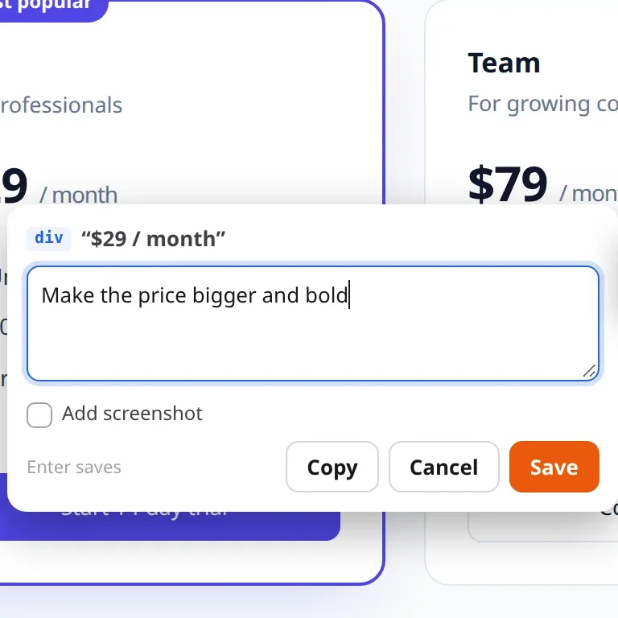
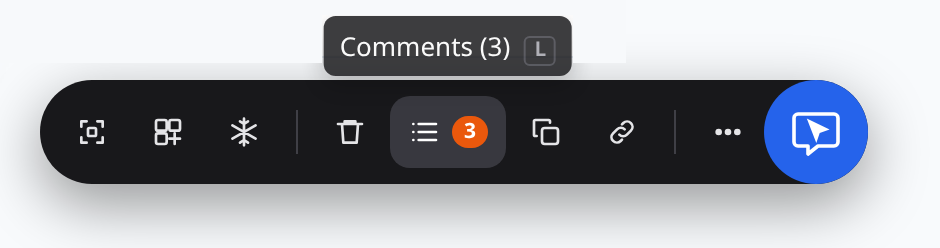
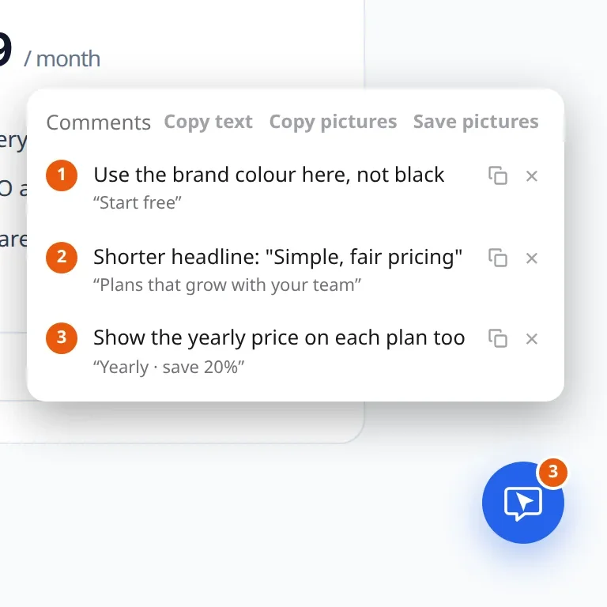

# Using page-comments

Every action, key and limit, in one place.
The [README](../README.md) has the short version.

**On this page**

- [🚀 Start and stop](#-start-and-stop): the bookmark, the extension, the console
- [👆 Point and comment](#-point-and-comment): the comment box and pins
- [📸 Pictures](#-pictures): Add screenshot
- [🔵 The round button](#-the-round-button): modes and the bar
- [🎯 More ways to point](#-more-ways-to-point): right-click, area, batch, freeze
- [🔑 Keys](#-keys)
- [📮 Hand it on](#-hand-it-on): Copy, Copy text, Copy pictures, Save pictures
- [🔗 Share link](#-share-link)
- [🤖 Send to Claude](#send-to-claude)
- [🔖 Which bookmark](#-which-bookmark)
- [🧩 The extension](#-the-extension)
- [💾 Where comments live](#-where-comments-live): storage and limits

## 🚀 Start and stop

Commenting is on as soon as the tool opens.

| Way | Open | Close |
|---|---|---|
| **Bookmark** | Click **🗨️ Page comments** | Click it again, or **⋯** → **Close** |
| **Extension** | Click its icon, or press <kbd>Alt</kbd>+<kbd>Shift</kbd>+<kbd>P</kbd> | **Close the tool** in its popup, <kbd>Alt</kbd>+<kbd>Shift</kbd>+<kbd>P</kbd>, or **⋯** → **Close** |
| **Console** | Paste [client.js](https://page-comments.share.heyadhi.com/client.js) into DevTools, then run `window.__pageCommentsLatest()` | Run `window.__pageCommentsLatest()` again |

- A bookmark cannot run by itself after a reload. Click it again: the comments come back with their pins.
- The extension can bring the pins back by itself, on sites you allow. See [The extension](#-the-extension).

## 👆 Point and comment

<p align="center">
  
</p>

1. **Hover** anything. An outline shows its tag, size and background colour.
2. **Click** an element, or **select** some text.
3. **Type** your comment and press <kbd>Enter</kbd>. A numbered pin stays on that spot.

| In the comment box | Does |
|---|---|
| The heading | Names the pick in plain words: "Pro — $29", the selected words, "3 elements" |
| The dark tab on its edge | Opens the details: size, colours, font, spacing, contrast, the selector, and **copy selector** |
| **Add screenshot** | Attaches a picture. See [Pictures](#-pictures) |
| **Copy** | Copies this comment as it is now, without saving it |
| <kbd>Enter</kbd> / <kbd>Shift</kbd>+<kbd>Enter</kbd> | Saves / starts a new line |

- <kbd>D</kbd> adds the details to the hover outline too: background, text colour, font, padding, radius and contrast.
  It is one remembered switch, shared with the dark tab.
- The hover details also go to Claude with **Send to Claude**.
- A click elsewhere closes an empty comment box. A half-written comment is never thrown away.
- Click a pin to edit or delete its comment.

## 📸 Pictures

Tick **Add screenshot** in the comment box to attach a picture of what the comment is on.
The tick is remembered per site.

| | Bookmark | Extension |
|---|---|---|
| **Asks first** | Chrome asks "Share this tab?" the first time. Sharing stays on until the tool closes. | Never |
| **Quality** | WebP, small | PNG, lossless |

- Pictures survive a reload. They are kept in the site's IndexedDB.
- Every picture is labelled with its comment's number.
  Pasted into a rich-text editor (Google Docs, email, Notion), the label is the number only, since the comment's text is right above it.
  The combined picture and the files from **Save pictures** keep the full "2 · comment" label.
- A comment on several picks gets one picture per pick: 2a, 2b, …

## 🔵 The round button

<p align="center">
  
</p>

| It shows | Meaning |
|---|---|
| **Blue** | Commenting: a click on the page picks what to comment on |
| **Dark** | Browsing: the page works as usual, the pins stay |
| **Orange badge** | How many comments this page has |
| **Green dot** | A new version is out: open **⋯** and click the green Help line |

- **Click** it to switch between commenting and browsing. Open popups close when browsing starts.
- <kbd>Alt</kbd>+<kbd>Shift</kbd>+<kbd>C</kbd> (<kbd>⌥⇧C</kbd> on a Mac) switches too, from either mode.
- <kbd>Esc</kbd> backs out one step at a time. Its last step ends commenting.
- **Drag** it anywhere. The spot is saved per site.

**The bar.** Hover the round button and it grows into a bar toward the middle of the screen.
Each action shows its name and key on hover.

| Part | Actions |
|---|---|
| Point | **Select an area** · **Select several** · **Freeze: 3 s to open a menu first** |
| Comments | **Clear all** (the bin) · **Comments** list · **Copy** · **Share link** · **Send to Claude** |
| **⋯** | **Details** · **Keyboard shortcuts** · **Help & install page** · **Close** |

- **Clear all** takes two clicks within 3 seconds. Armed, it turns red and says how many it will clear.
- **Send to Claude** shows only on your own dev app, while the local server runs. See [Send to Claude](#send-to-claude).
- While commenting, a small card above the round button lists the main keys, one per row.

## 🎯 More ways to point

These work while commenting.

| Way | Start it | Good for |
|---|---|---|
| **Right-click** | Right-click anything | The tool's own menu, with every way to pick |
| **Area** | <kbd>A</kbd>, or **Select an area**, then drag a box | Gaps, empty space, things side by side |
| **Batch** | <kbd>B</kbd>, **Select several**, the right-click menu, or <kbd>Shift</kbd>+click | One comment on several things |
| **Freeze** | <kbd>F</kbd>, <kbd>Alt</kbd>+<kbd>Shift</kbd>+<kbd>F</kbd>, or the bar's **Freeze** | Hover menus and tooltips that vanish when the mouse moves |

<details>
<summary><b>The right-click menu</b></summary>
<br>

- **Comment on this** (<kbd>Enter</kbd>)
- **Select parent** (<kbd>↑</kbd>) and **Select inner** (<kbd>↓</kbd>)
- **Select an area** (<kbd>A</kbd>)
- **Select several (batch)** (<kbd>B</kbd>)
- **Freeze the page** (<kbd>F</kbd>), or **Unfreeze** on a frozen page
- **Keyboard shortcuts** (<kbd>?</kbd>)
- **Copy selector**

</details>

<details>
<summary><b>Batch, step by step</b></summary>
<br>

1. Start a batch. Every click now adds or removes an element.
2. Press <kbd>A</kbd> to drag area boxes instead. <kbd>A</kbd> again goes back to elements.
   On a frozen page a drag always adds an area.
3. Press <kbd>Enter</kbd>, or **Comment** on the blue bar.
   One comment opens for all of them, anchored on their nearest common ancestor, with one picture of each pick (2a, 2b, …).
4. In the comment box, **‹ ›** step through the selections. Each comes into view, outlined solid, with the box beside it.

**Close without saving** or <kbd>Esc</kbd> asks "Drop the N selected?" first.

</details>

<details>
<summary><b>Freeze, step by step</b></summary>
<br>

Freeze records the page as a still picture, so hover menus and tooltips stay put.
You click, drag and right-click the picture just like the live page.

- <kbd>F</kbd> or <kbd>Alt</kbd>+<kbd>Shift</kbd>+<kbd>F</kbd> (<kbd>⌥⇧F</kbd>) freezes at once.
- The bar's **Freeze: 3 s to open a menu first** counts down 3 seconds, so you can open the page's menu with the mouse first.
- With the bookmark, the first press only starts tab sharing, because Chrome's prompt would close an open menu. Press again to freeze.
- <kbd>Esc</kbd> or **Unfreeze** ends it.

</details>

## 🔑 Keys

Single keys work while commenting, and never while you type in a field.

| Key | Does |
|---|---|
| <kbd>Enter</kbd> | Comment on the outlined element |
| <kbd>↑</kbd> <kbd>↓</kbd> | Outline the parent or the inner element |
| <kbd>A</kbd> | Select an area |
| <kbd>B</kbd> | Batch: select several |
| <kbd>Shift</kbd>+click | Start a batch with this element |
| <kbd>F</kbd> | Freeze or unfreeze |
| <kbd>D</kbd> | Details on or off |
| <kbd>L</kbd> | Comments list |
| <kbd>C</kbd> | Copy all comments |
| <kbd>S</kbd> | Share link |
| <kbd>Shift</kbd>+<kbd>S</kbd> | Change your name on share links |
| <kbd>?</kbd> | All shortcuts |
| <kbd>Esc</kbd> | Back out one step |
| <kbd>Alt</kbd>+<kbd>Shift</kbd>+<kbd>F</kbd> | Freeze, in either mode |
| <kbd>Alt</kbd>+<kbd>Shift</kbd>+<kbd>C</kbd> | Switch between commenting and browsing, in either mode |
| <kbd>Alt</kbd>+<kbd>Shift</kbd>+<kbd>P</kbd> | Start or close the tool (extension only) |

On a Mac, <kbd>Alt</kbd>+<kbd>Shift</kbd> is <kbd>⌥⇧</kbd>.

## 📮 Hand it on

<p align="center">
  
</p>

Every action works on **this page's comments only**.
A page is its URL without the `#hash`, so each page keeps its own comments, also in single-page apps.

| Action | Where | Puts out | Use it for |
|---|---|---|---|
| **Copy** | The bar, <kbd>C</kbd> | The text, plus one combined, numbered picture | Google Docs, email, Notion; terminals and Claude Code (<kbd>Ctrl</kbd>+<kbd>V</kbd> also pastes the picture) |
| **Copy** one comment | The copy button beside a comment in the list | That comment and its pictures | Slack, which puts all pictures after the text |
| **Copy text** | The top of the comments list | The text only, no pictures | Jira and Confluence: the first paste |
| **Copy pictures** | The top of the comments list | The pictures only, as one combined picture | Jira and Confluence: the second paste |
| **Save pictures** | The top of the comments list | Each picture as its own PNG, like `2a-make-it-bold.png` | Slack and other apps that should get separate pictures |
| **Share link** | The bar, <kbd>S</kbd> | A link with the comments inside | A teammate who can open the same page. See [Share link](#-share-link) |
| **Send to Claude** | The bar, local pages only | The comments and pictures, to Claude Code | Your own dev app. See [Send to Claude](#send-to-claude) |

Pasted into a rich-text editor, each comment reads: the comment, the plain name of what it is on, its pictures, then one small grey line of technical details.

<details>
<summary><b>Jira and Confluence take two pastes</b></summary>
<br>

Their editor drops the text when a paste holds a picture file and HTML with a picture.
It also drops pictures inside HTML.
So text and pictures go in two pastes:

1. Open the comments list (<kbd>L</kbd>) and click **Copy text**. Paste.
2. Click **Copy pictures**. Paste.

The tool shows this tip once per site, the first time you Copy comments with pictures.

</details>

<details>
<summary><b>Why Save pictures makes files</b></summary>
<br>

A page can put only one picture on the clipboard.
Apps that should get several separate pictures take them as files.

- **Bookmark:** one picture saves as a PNG. Several save as one zip, so they are one download: open it, then drag the pictures into Slack together.
- **Extension:** every picture saves as its own file in your Downloads folder.
- **Send to Claude** hands the pictures to Claude as files by itself.

</details>

## 🔗 Share link

**Share link** (<kbd>S</kbd>) copies a link to this page with its comments packed inside, after `#page-comments=`.

- Whoever opens the link and clicks their bookmark gets the comments, pins and pictures, saved as theirs.
- Opening a comment from the list scrolls to it and shows what it covers, dashed.
- It only helps for pages both people can open. Your localhost is not one of them, and the message says so.
- The first share on a site asks your name in a small bar. It is remembered; <kbd>Shift</kbd>+<kbd>S</kbd> changes it.

<details>
<summary><b>Size limits and pictures</b></summary>
<br>

- The link carries small copies of the pictures (1 pixel per CSS pixel, WebP quality 0.7, about 1.5 KB each) while it stays under 30 KB.
- Past 30 KB the link leaves the pictures out, and the message says so. Slack takes 40,000 characters a message.
- The person who opens a link without pictures is offered **Retake**. It takes those pictures on their page.
  Frozen pictures, and pictures whose element is missing, cannot be retaken.

</details>

<details>
<summary><b>Names and colours on shared comments</b></summary>
<br>

- Each comment carries its writer's name. Passed-on comments keep theirs.
- Comments that came in through a link show the writer's name: a chip in the comment box, the list line, the pin's tooltip, and "(from Name)" in Copy.
- They also show the writer's colour: the pin, the number and a mild row background.
- Each name gets one colour from a fixed list without blue or orange. Links without names stay purple.

</details>

<details>
<summary><b>What a link may carry</b></summary>
<br>

A link is someone else's data, so it is checked before use.
Comments of the wrong shape are dropped, and so is anything that should be a colour but is not one.

</details>

<a id="send-to-claude"></a>

## 🤖 Send to Claude

**Send to Claude** passes this page's comments and pictures to Claude Code, which edits your project's source files.
It works on your own dev app only.

**1. Start the server** in your project folder. It needs Node 18+ and the `claude` CLI on your PATH.

```sh
node server/server.js ~/projects/my-app        # or ~/page-comments-server.js, written by the install page's command
```

**2. Click Send to Claude.** The server runs `claude -p … --permission-mode acceptEdits` in that folder and prints the output in its terminal.

- Pictures go to a temporary folder Claude may read, deleted when Claude is done.
- One batch at a time. A second Send while Claude works gets "Claude is still working on the last batch".
- Send only makes sense for pages whose code is in the project folder.
- The **Send to Claude** action shows only while the server answers `GET /health`.
  The tool checks when you hover the round button, at most every 10 seconds, and only on local pages.
  Every failed check shows in the browser console, which is why it checks so rarely.

<details>
<summary><b>Which pages may send</b></summary>
<br>

Any website can send requests to your machine, so the server checks where each request comes from.
Only pages served from this machine may send:

- `localhost` and `*.localhost`
- loopback addresses (`127.x.x.x`, `[::1]`)
- names your hosts file points at a loopback address (`127.0.0.1`, `::1`)

The tool shows **Send to Claude** on `localhost`, loopback addresses, and the local-only endings `.localhost`, `.test`, `.local`, `.internal` and `.home.arpa`.
On a hosts-file name that looks like a public domain it does not show Send: use **Copy** there.

</details>

## 🔖 Which bookmark

There are three bookmarks. They run the same tool.

| | Orange bookmark | Fixed bookmark | GitHub copy |
|---|---|---|---|
| **Get it** | [Install page](https://page-comments.share.heyadhi.com/) | [Install page](https://page-comments.share.heyadhi.com/) | [`bookmarklet.txt`](../bookmarklet.txt) |
| **For** | Most people | Workplaces that allow no outside scripts | Networks that reach only github.com |
| **Loads code** | The published `client.js`, on each click | Never | Never |
| **Updates** | By itself | Drag a newer one | Copy a newer one |
| **Looks for new versions at** | The share site | The share site | The GitHub repository |
| **Help line opens** | The install page | The install page | The repository |

- The orange bookmark runs the copy it was built with when the site blocks outside scripts (CSP or Trusted Types: Gmail, GitHub, Jira), or when the load fails or takes over 3 seconds.
- The published `client.js` only defines `window.__pageCommentsLatest`, so it never runs on its own.
- A bookmark whose version differs from the published one shows the green dot on the round button.

<details>
<summary><b>Add the GitHub copy as a bookmark</b></summary>
<br>

1. Open [`bookmarklet.txt`](../bookmarklet.txt) on GitHub and click **Copy raw file**.
2. Right-click the bookmarks bar → **Add page…** (Firefox: **Add Bookmark…**).
3. Name it *Page comments* and paste into **URL**.

Every release updates `bookmarklet.txt`.

</details>

## 🧩 The extension

The extension runs the same tool, with sharper pictures. It is not in the stores yet: [load it unpacked](DEVELOPING.md#the-extension).

| You do | You get |
|---|---|
| Click its icon | The tool starts, and its popup opens |
| <kbd>Alt</kbd>+<kbd>Shift</kbd>+<kbd>P</kbd> | The tool starts or closes |
| **Close the tool** in the popup | The tool closes |
| **Allow** in the popup | Pins come back by themselves after a reload on this site, in browsing mode |
| **Not now** in the popup | The question never comes back on this site |
| The page list in the popup | Every page with comments, grouped by site, with a search |

- Pictures are lossless, and the browser never asks to share the tab.
- After a reload, sharp pictures need one click on the icon or the shortcut. That is the browser's rule.
- The click that closes the popup does not open a comment box.
- One tool per page: the bookmark hands over to the extension where the extension runs.

## 💾 Where comments live

Comments stay in your browser. Nothing leaves it unless you copy, share or send.

- Comments are saved in the site's own `localStorage`, so a reload keeps them. Pictures are in the site's IndexedDB.
- The site's own scripts could read them. Clearing the site's data deletes them.
- The bookmark and the extension use the same storage, so they see the same comments. Share links open in either.
- After a reload, elements are found again by their CSS selector.
  If the page changed and the selector no longer matches, the pin hides. The comment stays in the list and in Copy.

<details>
<summary><b>On pages that are not https</b></summary>
<br>

Browsers keep the clipboard and tab capture for secure pages: https, `localhost`, `127.0.0.1` and any `name.localhost`. A name from your hosts file (`myapp.test`, `myapp.local`) does not count, even when it points at your own machine. On a plain-http page:

| | Bookmark | Extension |
|---|---|---|
| **Copy** | Text and rich text (no combined picture for Slack) | Text and rich text, pictures inside |
| **Add screenshot** | Off, greyed out. Its tooltip says why and how to allow it (`chrome://flags/#unsafely-treat-insecure-origin-as-secure`, or open the site as `localhost` / `name.localhost`) | Works |
| **Copy pictures** | Not possible: use **Save pictures** | Not possible: use **Save pictures** |

</details>
